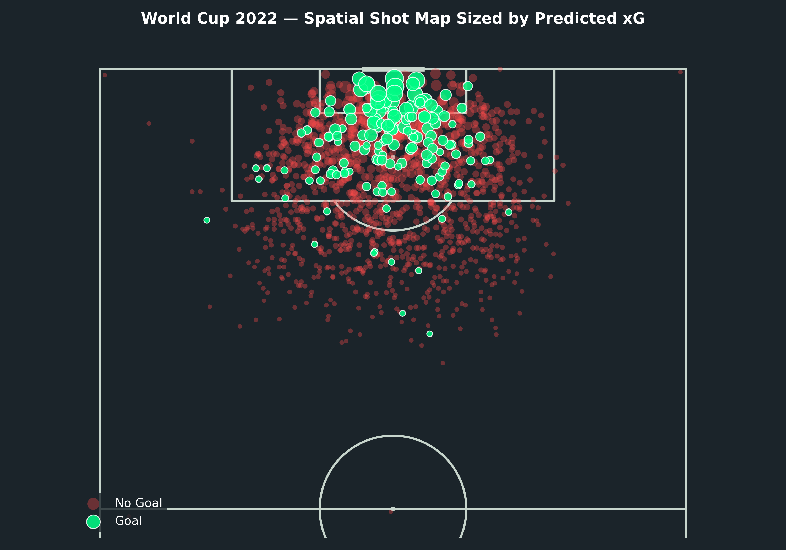
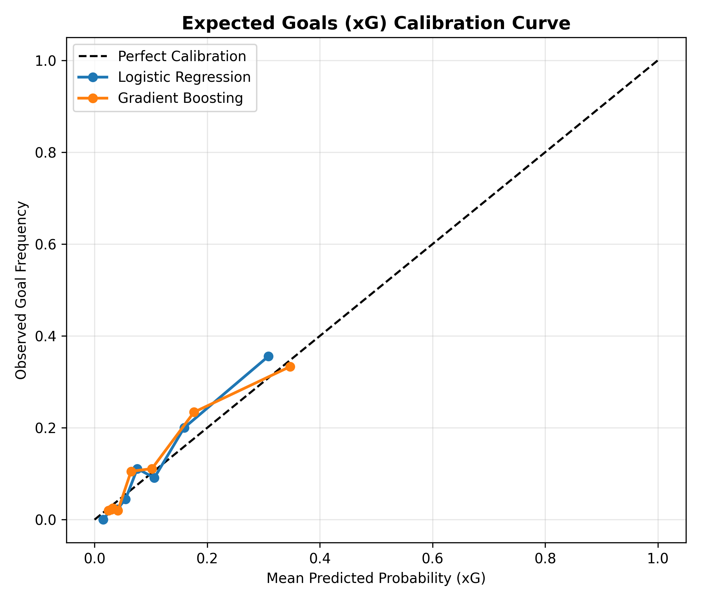

# Football Expected Goals (xG) Spatial & Probabilistic Modeling

A quantitative football analytics project modeling **Expected Goals (xG)** using open event-level data from the **FIFA World Cup 2022** (`statsbombpy`). The goal is to estimate calibrated scoring probabilities from spatial geometry and match context, comparing interpretable linear models against non-linear ensemble methods.

## Visual Overview

## Methodology & Feature Engineering

Non-penalty shots ($n > 1,400$) were extracted and transformed using analytical geometry on a $120 \times 80$ pitch coordinate system:
* **Euclidean Distance:** Distance from shot coordinates $(x, y)$ to the goal center $(120, 40)$.
* **Visible Goal Angle:** Exact angle $\theta$ subtended by the shot location and the two goalposts at $(120, 36)$ and $(120, 44)$.
* **Contextual Features:** Body part (`is_header`), defensive pressure (`under_pressure`), and transition state (`is_counter_attack`).

## Model Evaluation & Calibration

In sports betting and risk modeling, **probability calibration** is more critical than raw classification accuracy. Two models were trained and evaluated on an out-of-sample test set using **Log-Loss**, **Brier Score**, and **ROC-AUC**:
* **Logistic Regression** (interpretable baseline with naturally calibrated log-odds)
* **Gradient Boosting Classifier** (captures non-linear interactions between angle, distance, and pressure)

## Tech Stack
* **Python:** `pandas`, `numpy`, `scikit-learn`, `statsbombpy`, `mplsoccer`, `matplotlib`
